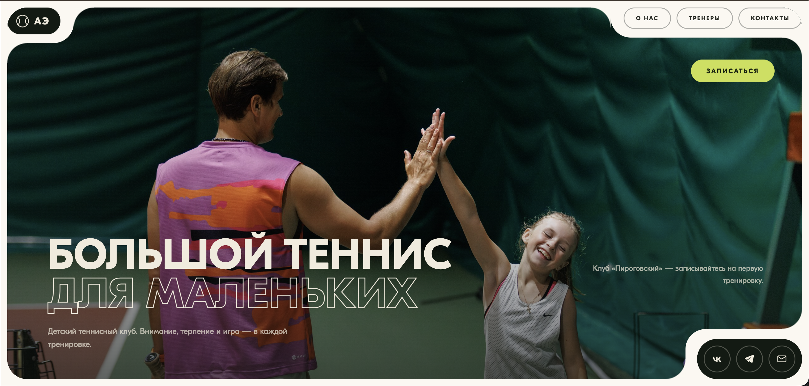
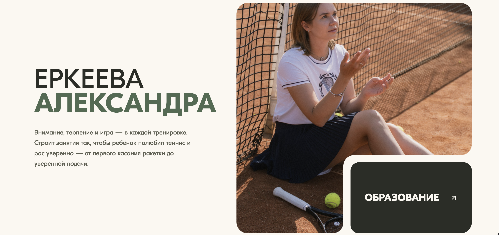
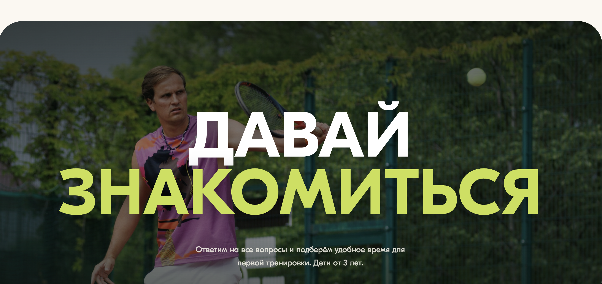

# Портфолио

Проект лендинг страницы для тренеров в теннисном клубе.

---

## Содержание

- [Статус проекта](#статус-проекта)
- [Ссылка на проект](#ссылка-на-проект)
- [Используемые технологии](#используемые-технологии)
- [Пример работы](#пример-работы)

---

## Статус проекта

Готовый (в процессе работы, допустимы правки)

---

## Ссылка на проект

```

пока нет, но есть ссылка на любимый трек мияги - https://music.yandex.ru/album/8412299/track/53729475?utm_source=desktop&utm_medium=copy_link

```

---

## Используемые технологии

- *ReactJS*
- *JavaScript*
- *TypeScript*
- *HTML*
- *Module.css*
- *GSAP*
- *CLAUDE* 
- *FIGMA*

---

## Пример работы
пока нет но надеемся я не поленюсь и сделаю фотки сайта, чтобы вы предварительно посмотрели


